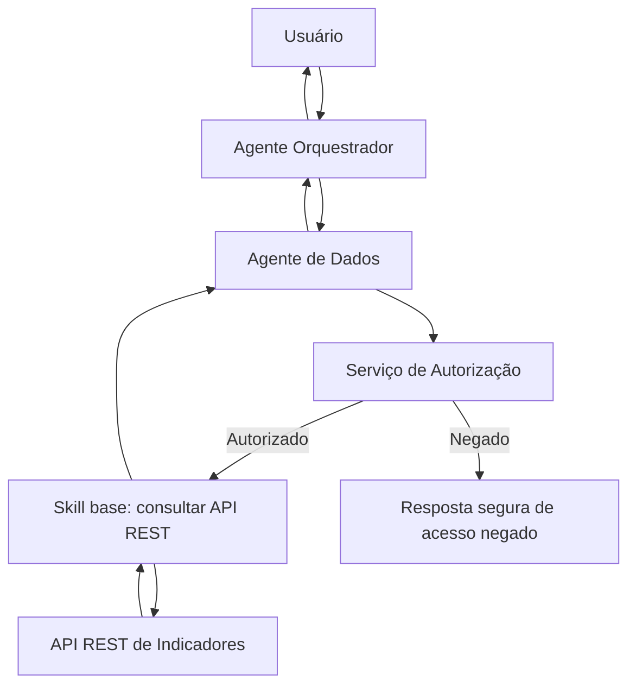

# Testes de Integração em uma Federação de Agentes de IA

> Projeto acadêmico | Engenharia de Prompts aplicada a testes de integração

## 1. Objetivo

Explorar o uso de modelos de linguagem (LLMs) para apoiar a **elaboração de casos de teste de integração** em uma arquitetura de **Federação de Agentes de IA**, com foco na construção de **skills base reutilizáveis**.

O experimento compara duas estratégias de prompting:

1. **Prompt funcional:** geração de cenários de integração, comunicação entre agentes, passagem de contexto e validação de contratos de API.
2. **Prompt de segurança e resiliência:** geração de cenários negativos, autorização, indisponibilidade de serviços e tratamento de falhas.

A intenção é avaliar como a especificidade e as restrições de cada prompt influenciam a **qualidade, a cobertura e a diversidade** dos casos propostos.

## 2. Cenário de integração

O cenário é **fictício e independente de dados ou sistemas corporativos reais**. Um usuário solicita um indicador de negócio e a federação coordena os componentes:



**Contrato ilustrativo (a ser validado/implementado no protótipo):**

- Operação: `GET /indicadores/{id}`.
- Entrada: identificador do indicador, contexto de usuário e identificador de correlação.
- Saída de sucesso: `200` com `id`, `valor`, `unidade` e `referencia`.
- Falhas previstas: `401` (não autenticado), `403` (não autorizado), `404` (não encontrado), `500` (erro interno) e timeout.
- Requisitos transversais: menor privilégio, nenhuma exposição de credenciais, validação de esquema e rastreabilidade por ID de correlação.

Essas definições são **premissas para os testes**, não descrições de uma API existente.

## 3. Prompts experimentais

### Prompt 1 — Cenários funcionais

```text
Atue como um engenheiro de QA especializado em sistemas multiagentes.

Considere uma federação de agentes composta por:
- Um agente orquestrador.
- Um agente especializado em dados.
- Uma skill reutilizável de consulta a APIs REST.
- Uma API que retorna indicadores de negócio.

Gere 6 casos de teste de integração entre esses componentes.

Para cada caso, informe:
1. Identificador do teste.
2. Objetivo.
3. Pré-condições.
4. Dados de entrada.
5. Componentes envolvidos.
6. Resultado esperado.

Inclua fluxos de sucesso, passagem de contexto, validação do contrato da API
 e retorno da informação ao agente orquestrador.

Não presuma funcionalidades que não estejam descritas.
Caso seja necessário, explicite as premissas.
```

### Prompt 2 — Segurança e resiliência

```text
Atue como um engenheiro de QA especializado em testes de integração,
segurança e resiliência de sistemas multiagentes.

Considere a mesma federação de agentes:
- Agente orquestrador.
- Agente de dados.
- Skill de consulta REST.
- Serviço de autorização.
- API externa.

Gere 8 casos de teste de integração priorizando:
- Falha de autenticação.
- Usuário sem permissão.
- Timeout de API.
- Indisponibilidade do serviço.
- Resposta com estrutura diferente do contrato.
- Dados sensíveis no retorno.
- Falha na comunicação entre agentes.
- Tentativa de executar ação fora das permissões da skill.

Para cada caso, informe identificador, pré-condições, entrada,
comportamento esperado e critério objetivo de aprovação.

Considere princípios de menor privilégio, rastreabilidade e tratamento seguro
 de erros. Diferencie o comportamento esperado dos componentes das premissas
 que ainda precisam ser implementadas.
```

## 4. Casos de teste iniciais

A tabela abaixo apresenta **exemplos ilustrativos** de cenários que podem ser produzidos pelos prompts. **Não representa execução ou resultado medido da LLM**: as saídas reais do experimento devem ser registradas em arquivos separados.

| ID | Origem | Cenário | Critério esperado |
|---|---|---|---|
| CT01 | Funcional | Roteamento para o agente de dados | O orquestrador aciona o agente correto. |
| CT02 | Funcional | Consulta da skill à API | Requisição e resposta seguem o contrato definido. |
| CT03 | Funcional | Propagação de contexto | Identificadores e parâmetros necessários são preservados. |
| CT04 | Segurança | Usuário sem autorização | Consulta não é executada e retorna acesso negado. |
| CT05 | Resiliência | Timeout da API | Falha é tratada e comunicada sem expor detalhes sensíveis. |
| CT06 | Segurança | Operação fora do escopo da skill | Execução é bloqueada e o evento é rastreável. |
| CT07 | Resiliência | Resposta incompatível com o esquema | Inconsistência é identificada antes do consumo. |
| CT08 | Segurança | Retorno com dados sensíveis não autorizados | Informação não é apresentada ao solicitante. |

Para transformar os cenários em testes executáveis, definir mocks, payloads, asserts e resultados esperados verificáveis.

## 5. Método de experimentação

1. Executar **cada prompt na mesma LLM**, registrando o nome/versão do modelo, data e configurações relevantes.
2. Salvar integralmente as respostas originais, sem edição, em `resultados-llm/`.
3. Normalizar os casos selecionados em `casos-de-teste/`, sem perder referência à resposta original.
4. Comparar os resultados utilizando os critérios abaixo.
5. Revisar os prompts e executar uma segunda rodada, documentando as alterações e seus efeitos.
6. Opcionalmente, implementar mocks e automatizar casos selecionados.

### Critérios de comparação

| Critério | Pergunta de avaliação |
|---|---|
| Clareza | O caso descreve fluxo, entrada e resultado verificável? |
| Cobertura | Quais integrações e componentes são contemplados? |
| Diversidade | Há cenários positivos, negativos, bordas e falhas? |
| Segurança | Considera autenticação, autorização e proteção de dados? |
| Executabilidade | Há informações suficientes para automatização futura? |
| Premissas | Distingue contratos definidos de comportamentos supostos? |

**Hipótese inicial (ainda não validada):** o prompt funcional tende a detalhar fluxos de sucesso, enquanto o prompt de segurança e resiliência tende a ampliar cenários negativos e de exceção.

### Registro dos ajustes de prompt

Preencher depois da execução:

| Rodada | Prompt | Ajuste realizado | Efeito observado |
|---|---|---|---|
| 1 | Funcional | Versão inicial | A registrar |
| 1 | Segurança/resiliência | Versão inicial | A registrar |
| 2 | A definir | A registrar | A registrar |

## 6. Estrutura sugerida do repositório

```text
federacao-agentes-testes-integracao/
├── README.md
├── prompts/
│   ├── 01-funcional.md
│   └── 02-seguranca-resiliencia.md
├── resultados-llm/
│   ├── rodada-1-funcional.md
│   └── rodada-1-seguranca.md
├── casos-de-teste/
│   └── casos-de-integracao.md
├── contratos/
│   └── indicadores-api-exemplo.json
└── analise-resultados.md
```

A estrutura acima é **proposta**; os arquivos complementares ainda precisam ser criados e preenchidos com os resultados do experimento.

## 7. Evolução prevista: skill de testes de integração

Como continuidade, o projeto poderá disponibilizar uma skill reutilizável denominada `integration-test-validator`, que receberá contratos de serviço e contexto de integração, produzirá casos estruturados e verificará requisitos de segurança, permissões e tratamento de erros. Posteriormente, poderá integrar uma suíte automatizada, por exemplo com `pytest` e APIs simuladas.

## 8. Estado do projeto

- [x] Definição do cenário fictício de integração.
- [x] Elaboração de dois prompts com objetivos distintos.
- [x] Exemplos iniciais de casos de teste documentados.
- [ ] Execução dos prompts em uma LLM e armazenamento das respostas.
- [ ] Comparação empírica de qualidade e diversidade.
- [ ] Refinamento e nova execução dos prompts.
- [ ] Implementação e execução automatizada dos testes (opcional).
- [ ] Publicação do repositório no GitHub.

**Observação:** a documentação não afirma que os prompts foram executados, que os testes passaram ou que o repositório já foi publicado.

## 9. Link do repositório

Adicionar aqui a URL do GitHub após sua criação.

---

**Uso acadêmico.** Todas as APIs, respostas, usuários e indicadores devem ser simulados, sem credenciais ou dados corporativos sensíveis.
